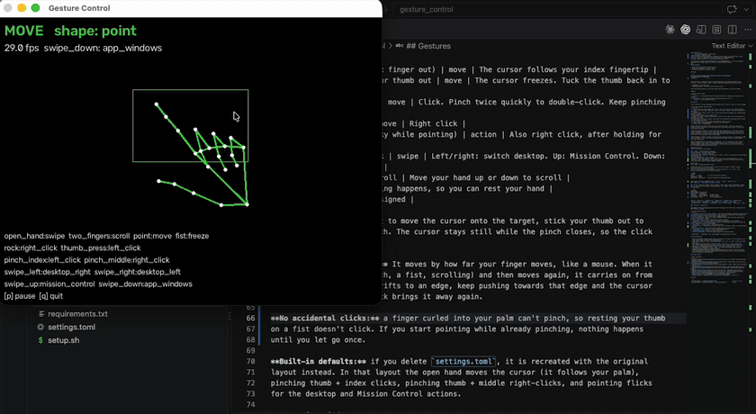
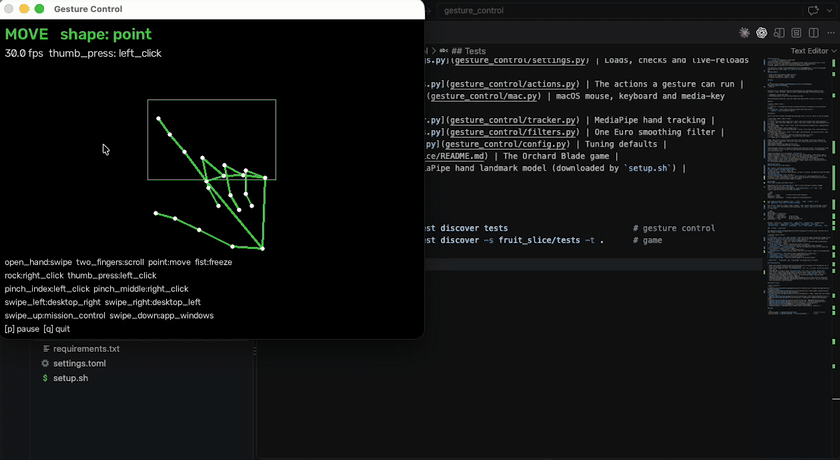
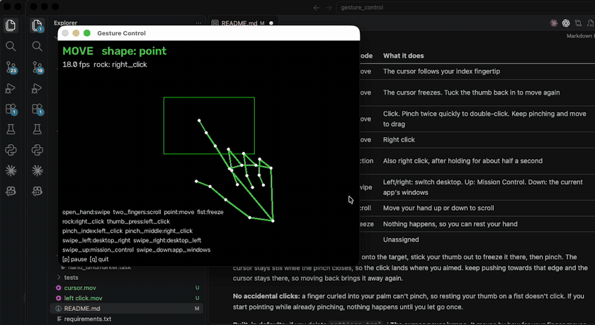
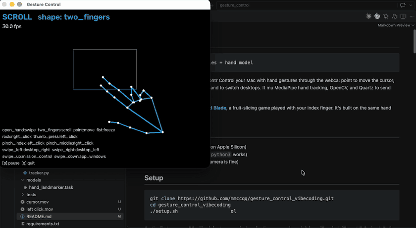

# Gesture Control

Control your Mac with hand gestures through the webcam: point to move the cursor, tuck
your thumb to click, flick your open hand to switch desktops. It uses MediaPipe hand
tracking, OpenCV, and Quartz to send mouse and keyboard events.

The repo also includes **[Orchard Blade](fruit_slice/README.md)**, a fruit-slicing game
played with your index finger. It's built on the same hand tracking.

## Demo

| Move the cursor | Click |
|---|---|
|  |  |
| **Right click** | **Scroll** |
|  |  |

## Requirements

- macOS (built and tested on Apple Silicon)
- Python 3.13 (Homebrew `python3` works)
- A webcam (the built-in camera is fine)

## Setup

```sh
git clone https://github.com/mmccqq/gesture_control_vibecoding.git
cd gesture_control_vibecoding
./setup.sh                          # venv + dependencies + hand model
.venv/bin/python -m gesture_control
```

On the first run, macOS will ask for two permissions for the app you launch it from
(Terminal, iTerm, VS Code…). Both are under **System Settings → Privacy & Security**:

- **Camera**: to see your hand
- **Accessibility**: to move the mouse and press keys

After granting a permission, quit and reopen that app with ⌘Q, not just its window.

Options:

| Option | What it does |
|---|---|
| `--dry-run` | Track gestures without touching the mouse or keyboard (no Accessibility needed) |
| `--no-preview` | Don't open the preview window (quit with Ctrl+C) |
| `--camera 1` | Use a different camera |

## Gestures

This is how the included [settings.toml](settings.toml) is set up. Every row can be changed.

| Hand shape | Mode | What it does |
|---|---|---|
| ☝️ Point (thumb out) | move | The cursor follows your index fingertip |
| ☝️ Point, then tuck your thumb | move | Click. Keep it tucked and move to drag. Tuck twice quickly to double-click |
| 🤘 Rock (raise your pinky while pointing) | action | Right click, after holding for about half a second |
| 🖐 Open hand, then flick | swipe | Left/right: switch desktop. Up: Mission Control. Down: the current app's windows |
| ✌️ Two fingers (V) | scroll | Move your hand up or down to scroll |
| ✊ Fist | freeze | Nothing happens, so you can rest your hand |
| 👍 Thumbs up | — | Unassigned |

**Clicking ("finger gun"):** point with your thumb sticking out to the side, like an L,
then press the thumb against the side of your hand. If you start pointing with your thumb
already tucked, nothing happens until you stick it out once. That stops you clicking just
by starting to point.

**Built-in defaults:** if you delete `settings.toml`, it is recreated with the original
layout instead. In that layout the open hand moves the cursor (it follows your palm),
pinching thumb + index clicks, pinching thumb + middle right-clicks, and pointing flicks
for the desktop and Mission Control actions.

### Preview window

The preview window shows your hand skeleton, the current mode, the hand shape it detects
(`shape: point`) and the gesture list. The rectangle is the **active box**: moving your
finger from one edge of the box to the other moves the cursor across the whole screen.
Press **p** to pause and **q** to quit. The camera image is hidden by default; set
`preview_camera_image = true` to show it.

## Settings

Everything lives in **`settings.toml`**. Edit it while the app is running: changes
apply as soon as you save. If an edit is invalid, the app prints why and keeps the
previous settings. The comments at the top of the file list every option.

### `[poses]`: what each hand shape does

Each shape is either a **mode** (`move`, `scroll`, `swipe`, `freeze`), an **action**
(it runs once when you hold the shape for `pose_action_hold_s`), or `"none"` (the
shape is ignored and the current mode continues).

```toml
[poses]
point     = "move"          # cursor follows your fingertip
open_hand = "swipe"
thumbs_up = "play_pause"    # hold a thumbs up to play/pause music
```

### `[gestures]`: what each click and flick does

`thumb_press` works when you point in move mode. The `pinch_*` gestures (thumb +
index / middle / ring / pinky) work in move mode with any other shape. The `swipe_*`
gestures are the flicks in swipe mode.

```toml
[gestures]
thumb_press = "left_click"      # "left_click" supports hold-to-drag
swipe_up    = "open:Safari"     # open an app
swipe_down  = "keys:cmd+tab"    # any key combo
pinch_ring  = "none"            # turn a gesture off
```

Actions: `left_click`, `double_click`, `right_click`, `desktop_left`, `desktop_right`,
`mission_control`, `app_windows`, `show_desktop`, `play_pause`, `next_track`,
`previous_track`, `volume_up`, `volume_down`, `mute`, `keys:<combo>`, `open:<App>`, `none`.

### `[tuning]`: sensitivity

See [gesture_control/config.py](gesture_control/config.py) for every value. The ones you're
most likely to change:

| Setting | What it does |
|---|---|
| `active_box = [left, top, right, bottom]` | The box in the camera view that maps to the whole screen, as fractions of the view from 0 to 1. Smaller = less movement needed, but tremor is magnified too |
| `cursor_deadzone_px` | The cursor ignores movement smaller than this many screen pixels. Raise it if the cursor shakes |
| `filter_min_cutoff` | Lower = smoother but slower to follow |
| `filter_beta` | Higher = less lag on fast moves (too high lets tremor through) |
| `thumb_press_start` / `thumb_press_release` | Thumb-tuck click sensitivity. Raise `thumb_press_start` if clicks don't register |
| `pinch_start` / `pinch_release` | Pinch sensitivity |
| `pose_action_hold_s` | How long to hold a shape before its action runs |
| `scroll_gain`, `scroll_invert` | Scroll speed and direction |
| `swipe_min_distance` | How far a flick must travel |
| `preview_camera_image` | Show the camera image in the preview window |

`camera_index`, `frame_width` and `frame_height` only apply after a restart.

## Troubleshooting

- **The cursor doesn't move:** check that Accessibility is turned on for the app you ran it
  from, and that you restarted that app afterwards.
- **The cursor shakes:** raise `cursor_deadzone_px` (try `12`), or lower `filter_min_cutoff`
  (try `0.5`).
- **A shape isn't recognized:** watch `shape:` in the preview window. Hold the hand
  clearly facing the camera, with good lighting.
- **Desktop switching or Mission Control does nothing:** turn on the Ctrl+arrow shortcuts
  in System Settings → Keyboard → Keyboard Shortcuts → Mission Control. You also need more
  than one desktop to switch between.

## Project layout

| Path | Contents |
|---|---|
| [gesture_control/controller.py](gesture_control/controller.py) | Decides the mode and what each gesture does |
| [gesture_control/gestures.py](gesture_control/gestures.py) | Hand shapes, pinch and thumb-press distances from the 21 hand landmarks |
| [gesture_control/settings.py](gesture_control/settings.py) | Loads, checks and live-reloads `settings.toml` |
| [gesture_control/actions.py](gesture_control/actions.py) | The actions a gesture can run |
| [gesture_control/mac.py](gesture_control/mac.py) | macOS mouse, keyboard and media-key events |
| [gesture_control/tracker.py](gesture_control/tracker.py) | MediaPipe hand tracking |
| [gesture_control/filters.py](gesture_control/filters.py) | One Euro smoothing filter |
| [gesture_control/config.py](gesture_control/config.py) | Tuning defaults |
| [fruit_slice/](fruit_slice/README.md) | The Orchard Blade game |
| [models/](models) | MediaPipe hand landmark model (downloaded by `setup.sh`) |

## Tests

```sh
.venv/bin/python -m unittest discover tests                          # gesture control
.venv/bin/python -m unittest discover -s fruit_slice/tests -t .      # game
```
